<div align="center">

<a href="https://pouryaak.github.io/wobnimo/">
  <picture><source media="(max-width: 640px)" srcset="https://raw.githubusercontent.com/Pouryaak/wobnimo/main/assets/repo-hero-mobile.svg?v=edf64a24"></picture>
</a>

<br>

<a href="https://pouryaak.github.io/wobnimo/">
  <picture>
    <source srcset="https://pouryaak.github.io/wobnimo/media/team.webp" type="image/webp">
    
  </picture>
</a>

<br>

<a href="https://pouryaak.github.io/wobnimo/"><picture></picture></a>&nbsp;&nbsp;<a href="https://www.npmjs.com/package/wobnimo"><picture></picture></a>&nbsp;&nbsp;<a href="https://pouryaak.github.io/wobnimo/llms.txt"><picture></picture></a>&nbsp;&nbsp;<a href="https://github.com/Pouryaak/wobnimo/tree/main/skills/wobnimo-mascot"><picture></picture></a>

</div>

<br>

<!-- 01 / FOR DEVELOPERS (Interactive Cream Band Code Switcher) -->
<picture><source media="(max-width: 640px)" srcset="https://raw.githubusercontent.com/Pouryaak/wobnimo/main/assets/sec-01-devs-mobile.svg?v=04087a7e"></picture>

<details name="wobnimo-dev-tabs" open>
<summary><picture><source media="(max-width: 640px)" srcset="https://raw.githubusercontent.com/Pouryaak/wobnimo/main/assets/tab-dev-html-cdn-mobile.svg?v=32bc427e"></picture></summary>

```html
<script type="module" src="https://cdn.jsdelivr.net/npm/wobnimo@0.2/dist/wobnimo.js"></script>

<wobnimo-mascot character="mochi" state="thinking"></wobnimo-mascot>
```

> Drop those two lines anywhere and a living 3D mascot is on your page.

</details>

<details name="wobnimo-dev-tabs">
<summary><picture><source media="(max-width: 640px)" srcset="https://raw.githubusercontent.com/Pouryaak/wobnimo/main/assets/tab-dev-react-nextjs-mobile.svg?v=0e64015c"></picture></summary>

```tsx
// npm i wobnimo
"use client";
import { Mascot } from 'wobnimo/react';

export function CopilotAvatar() {
  return <Mascot character="volt" state="thinking" style={{ width: 160, height: 160 }} />;
}
```

> Import one character (`wobnimo/characters/mochi`, ~1.2 KB) or the full cast — you only ship what you use.

</details>

<details name="wobnimo-dev-tabs">
<summary><picture><source media="(max-width: 640px)" srcset="https://raw.githubusercontent.com/Pouryaak/wobnimo/main/assets/tab-dev-vanilla-js-mobile.svg?v=98a7db5d"></picture></summary>

```ts
import { mount } from 'wobnimo';
import { mochi } from 'wobnimo/characters/mochi';

const mascot = mount(document.querySelector('#mascot'), mochi);
agent.on('status', (s) => mascot.setState(s));   // idle · thinking · speaking · celebrating…
mascot.setPalette({ jelly: '#ff5d8f' });          // recolour live, no rebuild
```

> Or register `<wobnimo-mascot>` once via `import "wobnimo/element"` in Vue, Svelte, or plain JS.

</details>

<br>

<!-- 02 / GIVE YOUR AI A FACE (Moods Showcase + 10-State Engine) -->
<picture><source media="(max-width: 640px)" srcset="https://raw.githubusercontent.com/Pouryaak/wobnimo/main/assets/sec-02-moods-mobile.svg?v=e5f62cbc"></picture>

<div align="center">
  <a href="https://pouryaak.github.io/wobnimo/">
    
  </a>
</div>

<picture><source media="(max-width: 640px)" srcset="https://raw.githubusercontent.com/Pouryaak/wobnimo/main/assets/panel-states-mobile.svg?v=859b7345"></picture>

```tsx
import { Mascot } from 'wobnimo/react';

const { status } = useChat(); // Vercel AI SDK

<Mascot character="mochi" status={status} />
```

<br>

<!-- 03 / DESCRIBE IT. GET IT. (The Agent Forge) -->
<picture><source media="(max-width: 640px)" srcset="https://raw.githubusercontent.com/Pouryaak/wobnimo/main/assets/sec-03-forge-mobile.svg?v=7e839363"></picture>

<picture><source media="(max-width: 640px)" srcset="https://raw.githubusercontent.com/Pouryaak/wobnimo/main/assets/panel-forge-mobile.svg?v=ec9b1890"></picture>

```bash
npx wobnimo skill                      # installs the skill for Claude Code, Codex, Cursor, OpenCode…
npx wobnimo check mascots/drift.ts     # measures real 3D geometry & reports exact coordinate fixes
npx wobnimo preview mascots/drift.ts   # renders front, side, back, face close-up & all 10 moods to PNG
```

<br>

<!-- 04 / FEATHERWEIGHT ARCHITECTURE -->
<picture><source media="(max-width: 640px)" srcset="https://raw.githubusercontent.com/Pouryaak/wobnimo/main/assets/sec-04-weight-mobile.svg?v=3317ee1d"></picture>

<picture><source media="(max-width: 640px)" srcset="https://raw.githubusercontent.com/Pouryaak/wobnimo/main/assets/panel-weight-mobile.svg?v=08648953"></picture>

<br><br>

<!-- 05 / THE CAST (Interactive 20-Mascot Explorer) -->
<picture><source media="(max-width: 640px)" srcset="https://raw.githubusercontent.com/Pouryaak/wobnimo/main/assets/sec-05-cast-mobile.svg?v=4c95c34f"></picture>

<details name="wobnimo-cast" open>
<summary><picture><source media="(max-width: 640px)" srcset="https://raw.githubusercontent.com/Pouryaak/wobnimo/main/assets/cast-originals-trigger-mobile.svg?v=d95b78a2"></picture></summary>
<br>
<picture><source media="(max-width: 640px)" srcset="https://raw.githubusercontent.com/Pouryaak/wobnimo/main/assets/cast-originals-stage-mobile.svg?v=36a28307"></picture>
<br>
</details>

<details name="wobnimo-cast">
<summary><picture><source media="(max-width: 640px)" srcset="https://raw.githubusercontent.com/Pouryaak/wobnimo/main/assets/cast-agent-made-trigger-mobile.svg?v=070ead07"></picture></summary>
<br>
<picture><source media="(max-width: 640px)" srcset="https://raw.githubusercontent.com/Pouryaak/wobnimo/main/assets/cast-agent-made-stage-mobile.svg?v=b71abd73"></picture>
<br>
</details>

<br>

<!-- FINALE -->
<a href="https://github.com/Pouryaak/wobnimo">
  <picture><source media="(max-width: 640px)" srcset="https://raw.githubusercontent.com/Pouryaak/wobnimo/main/assets/repo-finale-mobile.svg?v=d2f76522"></picture>
</a>
